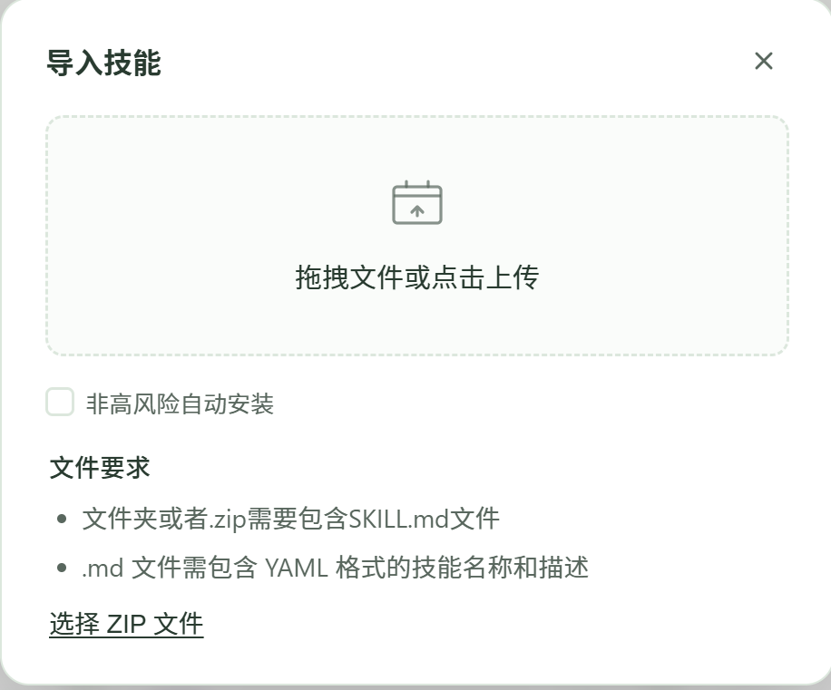

# three-layer-memory-recall · WorkBuddy三层记忆召回技能

给 WorkBuddy 用的技能：把**三层长期记忆**（用户级 `MEMORY.md` / 项目级 `MEMORY.md` / 最近几日日报）在**会话开头自动灌进上下文**，需要时再读全文，也可以按你的要求追加、修正、删除记忆条目。

> 技能的市场名称是 `three-layer-memory-recall`。当前版本 **v1.3.1**。

## 它解决什么

WorkBuddy 每轮注入的长期记忆是**截断版**，而「踩坑」条目常常正好被截断，于是同一个错误被反复踩。本技能做三件事：

1. **自动注入**：`SessionStart` hook 在开会话时输出一份 ≤18 KB 的精简版，按 `★` / 铁律 / 踩坑 / 纠正 加权挑章节，并明确列出哪些章节被省略。
2. **按需读全**：输入 `/three-layer-memory-recall` 时分层定位 + 分片读完全文（55 KB 级别也不会被平台截断）。
3. **按需维护**：你口述一条坑说「记下来」，或说「删掉那条」，它会落盘或删除，且只动你点名的那一条。

**只在你要它读的时候才读。** 普通问答不触发，不会白白吞 token；写到文件里的交付物也不会被任何回执块污染。

## 安装

两种方式，任选其一。

### 方式一：从技能市场安装

WorkBuddy 左侧栏「专家·技能·连接器」→「技能」，搜索 **长期记忆召回** 或 `three-layer-memory-recall`，点加号安装。

### 方式二：从 Releases 页面下载 ZIP 安装

1. **从 [Releases 页面](https://github.com/tony-he-xhxk/wb-memory-recall/releases) 下载技能 ZIP。** 解压到本地，并通过 WorkBuddy 的图形化界面，选择左侧栏“专家·技能·连接器”下的“技能”，右上角“添加技能”，选择“上传技能”，界面如下所示：



**点击底部的“选择 ZIP 文件”**，浏览到从 [Releases 页面](https://github.com/tony-he-xhxk/wb-memory-recall/releases) 下载的 ZIP，WorkBuddy 会自动审核本技能的安全性，手动点击“继续安装”以安装本技能。

## 注册会话启动钩子（可选）

不需要自动注入可以跳过本节，只用 `/three-layer-memory-recall` 手动唤起。

让 WorkBuddy 按 [SKILL.md 的「初始化（安装与自检）」](three-layer-memory-recall/SKILL.md) 编辑 `~/.workbuddy/settings.json`，加入 `hooks`（已有就合并）。参考提示词：

```
@skill:three-layer-memory-recall 按 SKILL.md 的初始化章节挂上 SessionStart hook
```

它会先问你要不要每个会话开头自动注入，得到确认后才动配置。**重启 WorkBuddy 需要你手动完成**——钩子只在启动时读配置，改完不热加载。

重启后点「新建任务」开一个新对话，原样发送下面这句验证：

```
能看到一个精简的记忆列出了踩坑等吗？之前我加了hook，这次是测试运行，看看这个hook有没有被挂上。
```

按提示词接到的回复判断：

| 现象 | 结论 |
| --- | --- |
| 出现 `<<<AUTO-MEMORY-DIGEST ...>>>` 且带记忆正文节选 | 挂上了 |
| 出现 `<<<AUTO-MEMORY-DIGEST \| 注入失败>>>` | 没挂上，看 `hook.log` 里的 `rc=` |
| 什么都没出现 | 没挂上，回到「注册会话启动钩子」核对 `settings.json` |

之后每开新对话都会自动注入精简版记忆；用 `/three-layer-memory-recall` 手动调用则读完整版，减少模型在记忆已写明的地方反复犯错的概率。

## 自检

不重启也能验证 hook 脚本本身：

```bash
bash "$HOME/.workbuddy/skills/three-layer-memory-recall/hooks/session-start.sh" | wc -c
```

判据**不是**绝对字节数（记忆多少、选了几节，输出就多大），看这三条：

- 输出 **≠ 0** 且不含 `注入失败` → 正常。字节数一般落在「三层记忆总量」的 70–90%，上限 18 KB（`--max-bytes` 可调）。记忆只有 7 KB 时输出 6.5 KB 完全正常。
- 输出 **= 0** → 这台机器还没有任何记忆文件（正常，不会注入噪音）。
- 出现 `<<<AUTO-MEMORY-DIGEST | 注入失败>>>` → 看 `~/.workbuddy/skills/three-layer-memory-recall/hook.log` 里的 `rc=`。

## 卸载

```bash
rm -rf ~/.workbuddy/skills/three-layer-memory-recall
```

再把 `settings.json` 里 `hooks.SessionStart` 中对应的一项删掉（或整体设为 `[]`），然后重启。

## 依赖

- `python3`（或 `python`）。脚本只用标准库。
- Windows 上钩子由 Git Bash 执行（WorkBuddy 强制），路径分隔符无关紧要。

## 文件

| 文件 | 作用 |
| --- | --- |
| `SKILL.md` | 技能本体：触发条件、读取流程、写入边界、隐私约定、反例 |
| `scripts/memory_bundle.py` | `locate`（元信息）/ `digest`（精简版）/ `pack`（全文分片） |
| `hooks/session-start.sh` | 会话启动钩子入口 |

## 许可

MIT，见 [LICENSE](LICENSE)。
