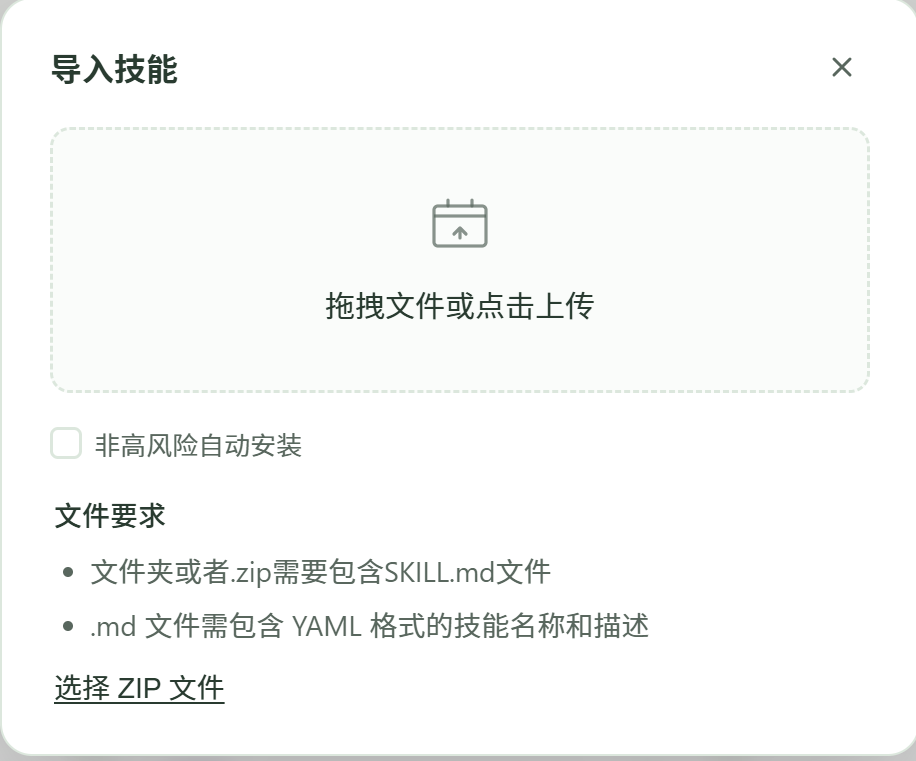

# memory-recall

给 WorkBuddy 用的技能：把**三层长期记忆**（用户级 `MEMORY.md` / 项目级 `MEMORY.md` / 最近几日日报）在**会话开头自动灌进上下文**，需要时再读全文。

## 它解决什么

WorkBuddy 每轮注入的长期记忆是**截断版**，而「踩坑」条目常常正好被截断，于是同一个错误被反复踩。本技能做两件事：

1. **自动注入**：`SessionStart` hook 在开会话时输出一份 ≤18 KB 的精简版，按 `★` / 铁律 / 踩坑 / 纠正 加权挑章节，并明确列出哪些章节被省略。
2. **按需读全**：输入 `/memory-recall` 时分层定位 + 分片读完全文（55 KB 级别也不会被平台截断）。

只读。不改你的记忆文件，不联网，唯一的写入是技能目录下的 `hook.log`（诊断用，可随时删）。

## 快速安装

1. **从 [Releases 页面](https://github.com/tony-he-xhxk/wb-memory-recall/releases) 下载技能 ZIP。** 解压到本地，并通过 WorkBuddy 的图形化界面，选择左侧栏“专家·技能·连接器”下的“技能”，右上角“添加技能”，选择“上传技能”，界面如下所示：



**点击底部的“选择 ZIP 文件”**，浏览到从 [Releases 页面](https://github.com/tony-he-xhxk/wb-memory-recall/releases) 下载的 ZIP，WorkBuddy 会自动审核本技能的安全性，手动点击“继续安装”以安装本技能。

2. **注册会话启动钩子。** 直接让WorkBuddy按照 [给WorkBuddy看的README文件](memory-recall/README.md) 编辑 `~/.workbuddy/settings.json`，加入 `hooks`（已有就合并）。

本步的参考提示词如下：

```
@skill:memory-recall 加载技能并且做README.md和SKILL.md要求的内容，明确读用户本地的三层记忆并注入上下文；按README所写挂上hook。
```

3. **重启 WorkBuddy**。钩子只在启动时读取配置，改完不热加载。

重启应用后，请给 WorkBuddy 发送如下提示词以检验钩子已挂载：

```
能看到一个精简的记忆列出了踩坑等吗？之前我加了hook，这次是测试运行，看看这个hook有没有被挂上。
```

接收到模型肯定回复，本技能所有步骤即初始化完成，之后每新开对话都会挂载 hook，WorkBuddy 即可看到精简版的用户记忆；用 `/memory-recall` 手动调用本技能，WorkBuddy 即可看到完整版的用户记忆，减少模型重复在记忆已载明的地方犯错的概率。

**注意：不需要自动注入可以跳过第 2、3 步，只用 `/memory-recall` 手动唤起。**

## 文件

| 文件                         | 作用                                         |
| -------------------------- | ------------------------------------------ |
| `SKILL.md`                 | 技能本体：规范、四步流程、隐私约定、反例                       |
| `scripts/memory_bundle.py` | `locate`（元信息）/ `digest`（精简版）/ `pack`（全文分片） |
| `hooks/session-start.sh`   | 会话启动钩子入口                                   |
